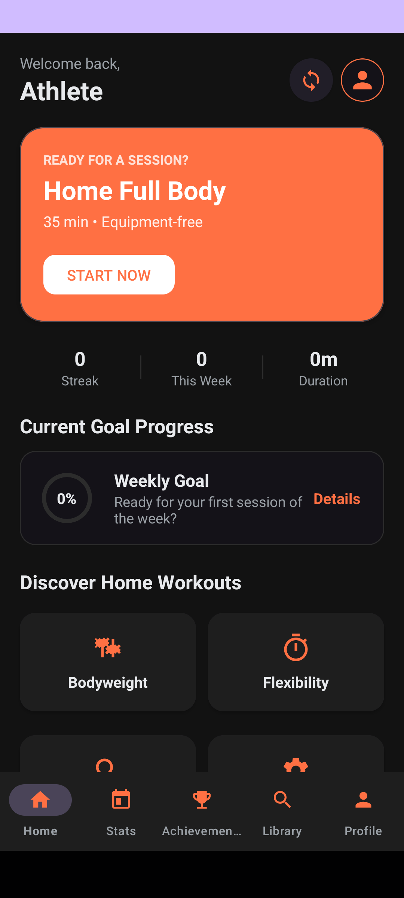
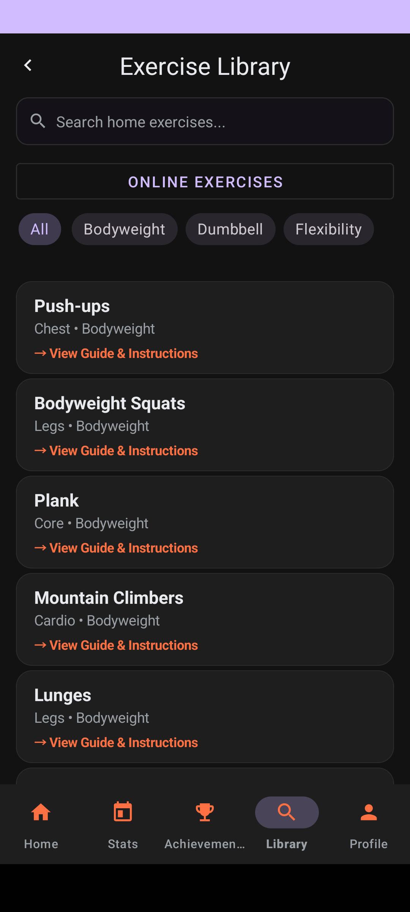
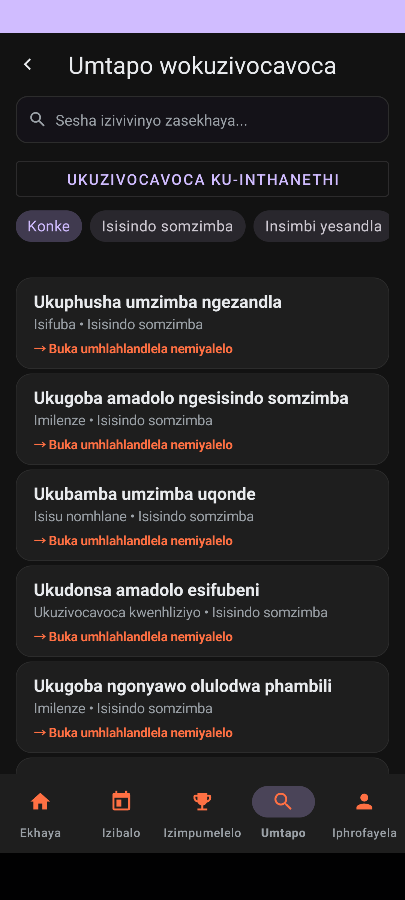

# RepSync

[](https://github.com/ST10377205/REPSYNC_app/actions/workflows/android-ci.yml)

RepSync is an Android fitness app developed for coursework. It helps users plan workouts, follow exercise guides, record sessions and track their training history. Completed workouts are saved on the phone first, with cloud synchronization for Google-linked accounts when internet access returns.


## Team and demonstration

- Lusani Ramulifho — ST10439607
- Kamohelo Simata — ST10377205
- Azwidali Manyaga — ST10440560

[Existing team demonstration video](https://youtu.be/0hu_loixIoE?si=luCidYTS5_V3E0hq). Record the final assignment demonstration with the current phone build and all required features.

## Features

- Local registration and login with BCrypt password verification.
- Google sign-in through Android Credential Manager and Firebase Authentication. Linking an existing local profile requires its local password.
- Built-in exercise library and a public wger REST API exercise browser with guides, equipment information, pagination and cached results.
- Workout plan generation, session timing, set tracking, saved workout summaries and progress views.
- Room database storage and WorkManager synchronization with private Cloud Firestore workout documents.
- Firebase Cloud Messaging updates, Android notification permissions and localized notification content.
- English, isiZulu and Afrikaans app controls and built-in exercise labels. The external wger exercise content is supplied in English.
- Light/dark themes and a consistent Preferences screen.

## App screenshots

These are direct captures of the app on a physical Android phone, using a temporary demonstration profile.

  

More screenshots are in [play-store/screenshots/phone](play-store/screenshots/phone).

## Development requirements

- Android Studio with support for Android Gradle Plugin 8.13.2.
- JDK 17 or newer. JDK 17 is used by GitHub Actions; the Android Studio bundled JBR also works locally.
- Android SDK Platform 36, Build Tools 35.0.0 and Platform Tools.
- An Android phone or emulator running API 24 or newer. The app targets API 36.
- Gradle 8.13, downloaded and checksum-verified by the included wrapper.

The app is written in Kotlin 2.0.21 and uses XML layouts, Room/KSP, WorkManager, Retrofit/Gson, Material Components and Firebase. Java/Kotlin bytecode targets Java 11.

## Open and build

1. Clone the repository and open its root folder in Android Studio.
2. Install Android SDK Platform 36 and Build Tools 35.0.0 in SDK Manager.
3. Let Android Studio create your local SDK configuration and sync Gradle.
4. Build and run the `app` debug configuration on your device.

Command line on Windows:

```powershell
./gradlew.bat assembleDebug
./gradlew.bat testDebugUnitTest lintDebug
```

On Linux/macOS:

```bash
chmod +x gradlew
./gradlew assembleDebug
./gradlew testDebugUnitTest lintDebug
```

The debug APK is generated at `app/build/outputs/apk/debug/app-debug.apk`. No release signing credentials are required for these commands.

## Firebase configuration

The repository intentionally excludes `google-services.json`. Basic local features and the public fitness API build without it. Google sign-in, remote push delivery and cloud synchronization need a real Firebase configuration.

1. Register the Android application ID `com.example.myapplication` in the Firebase project you are authorized to use.
2. Put the downloaded `google-services.json` in the `app/` directory. Do not use renamed downloads such as `google-services (1).json`.
3. Enable Google as a sign-in provider in Firebase Authentication.
4. Run `./gradlew signingReport` (or `./gradlew.bat signingReport`) and register your own debug SHA-1/SHA-256 certificates in that Firebase Android app. A new developer or CI machine has a different debug certificate.
5. Refresh the downloaded Firebase configuration if necessary, then rebuild.
6. Create Cloud Firestore and publish the owner-restricted rules from [firestore.rules](firestore.rules). This app uses **Cloud Firestore**, not Realtime Database, for workout synchronization.
7. Enable notifications on the phone and use Firebase Messaging's test flow to verify real delivery.

For existing team cloud data, ask the project owner for authorized access and the matching configuration. Do not overwrite another project's rules without reviewing them.

Detailed guides:

- [Google sign-in](GOOGLE_SIGN_IN.md)
- [Push notifications](PUSH_NOTIFICATIONS.md)
- [Offline workout synchronization](OFFLINE_SYNC.md)
- [Fitness REST API](FITNESS_API.md)

## Data flow

The workout summary is committed to Room before network synchronization starts. Google-linked records have a stable workout ID and owner UID. WorkManager retries eligible pending records when a connection is available. The corresponding Firestore path is `users/{uid}/workouts/{workoutId}`, and the repository and Firestore rules check ownership. Local-only profiles retain their records on the phone until explicitly linked through the Google workflow.

The wger integration calls `https://wger.de/api/v2/exerciseinfo/`. It downloads public catalogue pages, explicitly chooses English translations, converts descriptions to plain text and retains source/author/licence information. Saved pages are reused for up to 24 hours and can be returned when a request fails. New, uncached pages require internet access. RepSync account identifiers, workout records and Firebase tokens are not attached to wger requests.

## Automated tests

The GitHub Actions workflow is in [.github/workflows/android-ci.yml](.github/workflows/android-ci.yml). It runs on pushes, pull requests and manual dispatches:

1. Build the debug APK, run JVM unit tests and run Android lint.
2. Run the two isolated Room/account repository test classes on an Android emulator. They cover migrations, existing-account linking checks, offline persistence, stable IDs and ownership isolation without requiring live Firebase credentials.
3. Retain JUnit, test and lint reports as workflow artifacts, including when a check fails.

The current JVM suite contains 15 tests across authentication, password verification, notification content, workout validation/serialization and the example test. The two CI-selected instrumentation classes contain 10 tests. Other instrumentation tests cover language selection, notifications and exercise cache/UI behaviour.

To run the same isolated repository tests locally on an **expendable emulator**:

```bash
./gradlew connectedDebugAndroidTest -Pandroid.testInstrumentationRunnerArguments.class=com.example.myapplication.WorkoutRepositoryTest,com.example.myapplication.GoogleAccountRepositoryTest
```

Avoid Gradle's connected-test task on the phone used for your demonstration: its test setup/cleanup can uninstall the app. To preserve an existing phone installation, build `assembleDebug assembleDebugAndroidTest`, install both APKs with `adb install -r` (and `-t` for the test APK), and invoke `am instrument` directly.

Live-server tests are deliberately opt-in: `live_cloud=true` for Firestore verification and `live_fitness_api=true` for live wger checks. Screenshot capture requires `store_screenshots=true`. They are not part of the credential-free CI selection and are not evidence that real sign-in, push delivery or cloud access passed in GitHub Actions.

Reports are generated under `app/build/test-results/`, `app/build/reports/` and `app/build/outputs/androidTest-results/`. Check the latest Actions run for the actual hosted result; the badge above reports that run rather than a manually asserted status.

## Release and assignment evidence

The `play-store/` graphics and app screenshots document preparation for publication. Private registration screenshots are kept locally and are intentionally excluded from GitHub because they contain contact and payment-profile details. A screenshot of a payment request is not proof of payment or publication.

Signed builds use `tools/Initialize-ReleaseSigning.ps1` and `tools/Build-Release.ps1`. The key and Windows-protected password stay outside the repository; no APK, app bundle, private signing file, service-account key, device database or personal registration image should be committed.

The signed release certificate differs from the debug certificate. Register it with Firebase before testing release Google sign-in. Do not uninstall a working phone build just to replace it with a differently signed APK, because uninstalling removes local data.

The `repsync-backend/` folder and legacy `WorkoutApiService` are retained from the team history. The current Android app uses the wger API and owner-restricted Firestore workflow described above; it does not call that legacy backend.

## Current limits

- Public publication still needs finalized developer/privacy details, account deletion and release-device testing.
- Local email/password recovery currently permits a reset using an email and new password without a separate ownership-verification step. It must be replaced with verified recovery before public deployment.
- Fitness content is general exercise information; RepSync does not diagnose or treat medical conditions.
- A complete mark-by-mark assessment still depends on the original Part 1 proposal and lecturer feedback.

## References and attribution

- [Android developer documentation](https://developer.android.com/docs)
- [Firebase Android setup](https://firebase.google.com/docs/android/setup)
- [Firebase Cloud Messaging](https://firebase.google.com/docs/cloud-messaging)
- [Cloud Firestore security rules](https://firebase.google.com/docs/firestore/security/get-started)
- [wger API documentation](https://wger.readthedocs.io/en/latest/api/api.html)
- [GitHub Actions with Gradle](https://docs.github.com/en/actions/tutorials/build-and-test-code/java-with-gradle)

wger exercise content retains the licence and author shown in each exercise guide. Development and documentation have used AI assistance; see the concise [AI-use write-up](AI_USE.md) and [PDF](AI_USE.pdf).
